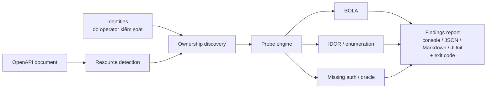

# AuthProbe: Phát hiện BOLA/IDOR trong API tuyển dụng bằng kiểm thử đa danh tính dựa trên đặc tả OpenAPI

> **Báo cáo tóm tắt và phân tích công cụ AuthProbe**
> Nguồn: Barach, J. (2026). *AuthProbe: Specification-Driven, Multi-Identity Detection of Broken Object-Level Authorization in Recruitment APIs*. arXiv:2607.20574v1 [cs.CR], 22/07/2026.
> Mã nguồn công cụ: <https://github.com/jbarach2012/AuthProbe> (giấy phép Apache 2.0)

---

## Mục lục

1. [Tổng quan](#1-tổng-quan)
2. [Bối cảnh và động cơ](#2-bối-cảnh-và-động-cơ)
3. [Mô hình đe dọa và định nghĩa bài toán](#3-mô-hình-đe-dọa-và-định-nghĩa-bài-toán)
4. [Kiến trúc hệ thống](#4-kiến-trúc-hệ-thống)
5. [Phương pháp phát hiện](#5-phương-pháp-phát-hiện)
6. [Triển khai và sử dụng](#6-triển-khai-và-sử-dụng)
7. [Đánh giá thực nghiệm](#7-đánh-giá-thực-nghiệm)
8. [Hạn chế và mối đe dọa đến tính hợp lệ](#8-hạn-chế-và-mối-đe-dọa-đến-tính-hợp-lệ)
9. [Khía cạnh đạo đức và pháp lý](#9-khía-cạnh-đạo-đức-và-pháp-lý)
10. [So sánh với các công trình liên quan](#10-so-sánh-với-các-công-trình-liên-quan)
11. [Nhận xét](#11-nhận-xét)
12. [Hướng phát triển](#12-hướng-phát-triển)
13. [Tài liệu tham khảo chính](#13-tài-liệu-tham-khảo-chính)

---

## 1. Tổng quan

| Mục | Nội dung |
|---|---|
| **Tên công cụ** | AuthProbe |
| **Mục tiêu** | Phát hiện *Broken Object-Level Authorization* (BOLA) / *Insecure Direct Object Reference* (IDOR) trong HTTP API |
| **Kiểu tiếp cận** | Black-box, dựa trên đặc tả OpenAPI, kiểm thử bằng **hai hay nhiều danh tính** do người vận hành kiểm soát |
| **Đầu vào** | URL đích, tài liệu OpenAPI (tự lấy từ dịch vụ hoặc cung cấp dạng tệp), tệp cấu hình liệt kê ≥ 2 danh tính (dạng HTTP header) |
| **Đầu ra** | Báo cáo console / JSON / Markdown / JUnit và **exit code theo ngưỡng mức độ nghiêm trọng** để chặn build CI |
| **Ngôn ngữ** | Python (chỉ cần một HTTP client nhỏ và bộ phân tích YAML) |
| **Phạm vi** | Đường **đọc** (GET) của thao tác lấy một đối tượng (item operation) |
| **Giấy phép** | Apache 2.0, có cơ chế bảo vệ "chỉ dùng khi được ủy quyền" |
| **Kết quả chính** | Phát hiện toàn bộ lỗi BOLA được cài sẵn, không có cảnh báo sai trên bản đã vá, thời gian quét tăng gần tuyến tính theo số đối tượng |

**Ý tưởng chính:** Một yêu cầu BOLA có phiên hợp lệ, đường dẫn đúng cú pháp và không có chuỗi payload nào, nên WAF dựa trên chữ ký hay máy quét đơn danh tính đều không nhận ra. AuthProbe giải quyết bằng cách: (1) với mỗi danh tính, tìm ra những đối tượng mà danh tính đó **sở hữu hợp lệ** (theo chính API tự khẳng định qua thao tác liệt kê); (2) dùng danh tính A để đọc đối tượng của danh tính B; (3) **xác nhận rò rỉ** bằng cách kiểm tra phản hồi có đúng là đối tượng của B hay không.

---

## 2. Bối cảnh và động cơ

### 2.1. Sự cố McHire (2025)

Bài báo dùng sự cố McHire làm ví dụ thúc đẩy nghiên cứu:

- Hai nhà nghiên cứu đăng nhập vào một tài khoản quản trị thử nghiệm bị bỏ quên trên nền tảng chatbot tuyển dụng, với thông tin đăng nhập `123456`/`123456`, không có xác thực hai yếu tố.
- Một endpoint nội bộ nhận định danh ứng viên dạng số tuần tự; chỉ cần giảm dần số này là lấy được nội dung chat và thông tin liên hệ của bất kỳ ứng viên nào.
- Mức độ lộ được nêu là cỡ **64 triệu bản ghi**; tuy nhiên nhà cung cấp phản bác quy mô thực tế và cho rằng chỉ một số ít bản ghi bị xem. Lỗi nền tảng thì không bị tranh cãi: endpoint xác thực người gọi nhưng không kiểm tra người đó có quyền đọc đối tượng cụ thể hay không.

### 2.2. BOLA trong OWASP

- BOLA đứng đầu OWASP API Security Top 10 từ 2019 và vẫn là **API1:2023**.
- Tương ứng với **CWE-639** (Authorization Bypass Through User-Controlled Key), nằm dưới CWE-284.

### 2.3. Vì sao API tuyển dụng đặc biệt đáng chú ý

Hệ thống tuyển dụng tập trung nhiều dữ liệu cá nhân (tên, liên hệ, địa chỉ, lịch sử làm việc, kết quả đánh giá, bản ghi chat), tích hợp dày đặc với chatbot, kiểm tra lý lịch, job board, đồng thời chịu áp lực thương mại phải onboard nhanh. Một lỗi thiếu kiểm tra sở hữu có thể làm lộ toàn bộ tập ứng viên.

---

## 3. Mô hình đe dọa và định nghĩa bài toán

- Gọi **U** là tập các chủ thể (principal), **R** là một loại tài nguyên. Mỗi đối tượng *o* có chủ sở hữu `own(o) ∈ U` và được truy cập qua một định danh.
- API có thao tác **collection** (liệt kê các đối tượng người gọi được thấy) và thao tác **item** (trả về một đối tượng theo định danh).
- **Định nghĩa sở hữu (ground truth):** nếu chủ thể *u* liệt kê collection và thấy đối tượng *o*, thì *u* được quyền đọc *o*. Định nghĩa này lấy từ chính hành vi của API, nên tester không phải đoán chính sách bên ngoài.
- **Kẻ tấn công** là chủ thể *a* có phiên hợp lệ nhưng đọc được đối tượng *o* không thuộc quyền của mình.
- **Lỗ hổng BOLA** tồn tại nếu có cặp (*a*, *o*) sao cho *a* không được quyền với *o* nhưng thao tác item gọi bằng thông tin của *a* và định danh của *o* vẫn trả về *o*.

Hai điểm tinh tế:
1. Mã trạng thái thành công **chưa đủ** để kết luận rò rỉ (một số API trả thân phản hồi chung chung cho yêu cầu bị từ chối) → phải xác nhận đúng là đối tượng của nạn nhân.
2. Tester chỉ suy luận được trên các đối tượng nó gọi tên được → cần bước **khám phá quyền sở hữu** trước.

---

## 4. Kiến trúc hệ thống



Bốn giai đoạn:

1. **Phát hiện tài nguyên (resource detection):** quét `paths` của OpenAPI để tìm cặp đường dẫn *collection* (ví dụ `/applications`) và *item* có đúng một tham số path (ví dụ `/applications/{app_id}`), cả hai đều có GET. Trường định danh được suy ra từ schema phản hồi, mặc định là `id`. Có thể ghi đè trong cấu hình nếu đặc tả không theo quy ước.
2. **Khám phá quyền sở hữu:** với mỗi danh tính và mỗi tài nguyên, gọi collection và ghi nhận các định danh trả về.
3. **Chạy các probe:** bốn probe cho mỗi tài nguyên (mục 5).
4. **Xuất báo cáo:** ra console, JSON, Markdown, JUnit và đặt exit code theo ngưỡng mức độ.

Công cụ **không lưu trạng thái giữa các lần chạy** và **không cần agent bên trong đích**, nên dùng như một bước kiểm thử đơn vị trong CI.

---

## 5. Phương pháp phát hiện

### 5.1. Phát hiện tài nguyên (Algorithm 1)

Duyệt mọi path *p* trong đặc tả; nếu *p* có dạng `(coll)/{param}` và có GET, và `coll` cũng là path có GET, thì thêm tài nguyên gồm: tên, đường dẫn danh sách, đường dẫn lấy item, tên tham số và trường định danh.

### 5.2. Khám phá sở hữu và phát hiện BOLA (Algorithm 2)

1. Với mỗi danh tính *u*: `own[u] ← ids(GET collection bằng u)`.
2. **Ground truth:** với mỗi *u* và mỗi *o ∈ own[u]*, lấy `view[o]` bằng cách GET item với tư cách chủ sở hữu.
3. Với mọi cặp (kẻ tấn công *a*, nạn nhân *v*), *v ≠ a*, và mọi *o ∈ own[v]* mà *o ∉ own[a]*: GET item *o* bằng danh tính *a*.
4. Nếu thỏa **vị từ rò rỉ**, thêm phát hiện BOLA (*a*, *v*, *o*).

**Vị từ rò rỉ:**

```text
Leak(a, o) ≡ ok(r) ∧ obj(r) ∧ id(r) = id(o)
```

Tức là: phản hồi có trạng thái thành công, thân là một đối tượng, **và** trường định danh bằng định danh được yêu cầu. Điều kiện cuối loại các trường hợp trả mã thành công kèm thân lỗi chung chung hoặc dữ liệu giữ chỗ.

### 5.3. Liệt kê định danh (Algorithm 3)

- Nếu mọi định danh quan sát được đều là số → gắn cờ **định danh có thể liệt kê** (dễ đoán).
- Lấy một định danh *b* mà danh tính *u* sở hữu, thử các định danh lân cận `b ± δ` với `δ ∈ {1..k}`.
- Nếu chạm được đối tượng không thuộc *u* → phát hiện **IDOR** (định danh vừa đoán được vừa không được bảo vệ).

### 5.4. Thiếu xác thực và "existence oracle"

- **Missing authentication:** lặp lại các yêu cầu collection và item **không có thông tin xác thực**; nếu trả dữ liệu → mức **critical** (ứng với API2:2023).
- **Existence oracle:** so sánh mã trạng thái giữa đối tượng *tồn tại nhưng không được phép* và đối tượng *không tồn tại*. Nếu khác nhau (ví dụ 403 so với 404), kẻ tấn công xác nhận được định danh nào có thật → mức **low**. Bản vá đúng là trả cùng một mã not-found cho cả hai.

### 5.5. Bảng probe và mức độ nghiêm trọng

| Probe | OWASP | Mức độ | Tín hiệu kích hoạt |
|---|---|---|---|
| BOLA | API1:2023 | High | Đối tượng của nạn nhân được trả cho kẻ tấn công |
| IDOR walk | API1:2023 | High | Chạm tới đối tượng không sở hữu bằng cách bước qua định danh |
| Enumerable id | API1:2023 | Medium | Mọi định danh đều là số |
| Missing auth | API2:2023 | Critical | Trả dữ liệu khi không có thông tin xác thực |
| Existence oracle | API1:2023 | Low | Mã trạng thái "bị cấm" và "không tồn tại" khác nhau |

Thang mức độ: informational < low < medium < high < critical. Ngưỡng `fail_on` mặc định là **high**; khi có phát hiện đạt ngưỡng, công cụ thoát với mã khác 0 để làm hỏng bước CI.

### 5.6. Độ phức tạp, tính đúng đắn và tính đầy đủ

- **Số request:** khám phá sở hữu `|I|` request collection; ground truth `|I|·m` request item; lượt chéo tối đa `|I|(|I|−1)·m` request item → tổng **O(|I|²·m)**. Vì số danh tính nhỏ và cố định nên tuyến tính theo *m* (số đối tượng mẫu mỗi danh tính do người vận hành chọn).
- **Soundness (theo định nghĩa sở hữu ở mục 3):** phát hiện chỉ được nêu khi đối tượng nạn nhân thật sự được trả cho người không được phép.
- **Không đầy đủ (not complete):** chỉ kiểm thử được đối tượng khám phá được; API không có thao tác liệt kê và dùng định danh không đoán được sẽ có ít thứ để kiểm thử; có thể bỏ sót khi thân phản hồi bị biến đổi và không còn chứa định danh. Có thể giảm bằng seed tường minh hoặc custom body matcher.
- Thiết kế chủ động **đánh đổi một phần độ đầy đủ để lấy tỷ lệ cảnh báo sai thấp**, vì máy quét hay báo sai sẽ bị bỏ qua trong pipeline.

---

## 6. Triển khai và sử dụng

### 6.1. Thành phần

- Python, phụ thuộc tối thiểu (HTTP client + YAML parser).
- Giao diện dòng lệnh với một lệnh con `scan`: đọc cấu hình, chọn định dạng báo cáo, ghi vào thư mục, đặt exit code.
- **Báo cáo:** console (tóm tắt cho người), JSON (cho máy), Markdown (cho comment pull request), JUnit (hiển thị mỗi phát hiện như một test lỗi).
- **Hai dịch vụ đích kèm theo** (dùng framework web Python phổ biến):
  - *Vulnerable:* cấp định danh số nguyên tuần tự; endpoint item xác thực người gọi nhưng **không kiểm tra sở hữu** (tái hiện lớp lỗi McHire).
  - *Hardened:* cấp UUID không tuần tự, kiểm tra sở hữu theo nguyên tắc deny-by-default tại điểm truy cập, trả mã not-found đồng nhất cho đối tượng không được phép lẫn không tồn tại.
  - Hai dịch vụ có cùng hợp đồng API nên một cấu hình quét được cả hai.

### 6.2. Cấu hình mẫu

```yaml
target:
  base_url: "http://127.0.0.1:8000"
  spec: "auto"
identities:
  - name: alice
    headers: { Authorization: "Bearer alice-token" }
  - name: bob
    headers: { Authorization: "Bearer bob-token" }
settings:
  fail_on: high
```

Mỗi danh tính là một tập header nên hỗ trợ bearer token, API key và session cookie mà không cần xử lý riêng.

### 6.3. Dùng làm cổng CI

```yaml
- name: AuthProbe
  run: |
    authprobe scan --config authprobe.yaml \
      --format junit --out out/ --fail-on high
```

### 6.4. Mô hình triển khai

| Mô hình | Cách dùng |
|---|---|
| **Pipeline** | Chạy ở mỗi build trên một phiên bản tạm thời của dịch vụ để bắt hồi quy sớm |
| **Staging** | Chạy theo lịch trên môi trường tiền sản xuất với tài khoản tổng hợp (gồm cả gateway, reverse proxy) |
| **Assessment** | Người kiểm thử được ủy quyền chạy một lần trên hệ thống thật hoặc gần thật, dùng cờ xác nhận |

### 6.5. Khả năng mở rộng

Mỗi probe là một hàm độc lập nhận bản đồ sở hữu và trả về phát hiện; reporter là plugin (có thể thêm SARIF); việc tạo danh tính là một adapter nhỏ (có thể thay bằng luồng đăng nhập).

---

## 7. Đánh giá thực nghiệm

### 7.1. Thiết lập

- Hai dịch vụ đích chạy trên một máy, hai danh tính `alice` và `bob`; dữ liệu lưu trong bộ nhớ và được reset trước mỗi lần chạy.
- Thí nghiệm phát hiện/cảnh báo sai: mỗi danh tính tạo **3 ứng dụng (application)**.
- Thí nghiệm mở rộng: mỗi danh tính tạo từ **1 đến 50** ứng dụng.
- Dữ liệu hoàn toàn là dữ liệu giả.

### 7.2. Phát hiện và cảnh báo sai

**Bảng III – Số phát hiện theo mức độ (3 application mỗi danh tính)**

| Đích | Critical | High | Medium | Low |
|---|---:|---:|---:|---:|
| Vulnerable | 0 | 7 | 1 | 0 |
| Hardened | 0 | 0 | 0 | 0 |

Trên bản dễ bị tấn công: 7 phát hiện *high* gồm các lượt đọc chéo xác nhận ở cả hai chiều (alice đọc từng đối tượng của bob và ngược lại, 3 + 3 = 6) cộng một lượt liệt kê định danh thành công; 1 phát hiện *medium* là lược đồ định danh số. Bản đã vá: **không có phát hiện nào**. Ngưỡng *high* phân tách sạch hai đích.

### 7.3. Khả năng mở rộng

**Bảng IV – Số liệu đo trên bản Vulnerable**

| Đối tượng / danh tính | Thời gian quét (ms) | Số phát hiện |
|---:|---:|---:|
| 1 | 16 | 4 |
| 2 | 19 | 6 |
| 5 | 24 | 12 |
| 10 | 33 | 22 |
| 20 | 54 | 42 |
| 50 | 114 | 102 |

- Thời gian tăng từ 16 ms lên 114 ms, **gần tuyến tính** theo số đối tượng, phù hợp phân tích chi phí.
- Số phát hiện tăng theo công thức `2m + 2` (mỗi đối tượng nạn nhân mỗi kẻ tấn công cho một phát hiện BOLA, cộng hai phát hiện cố định: IDOR walk và enumerable-id).
- Về số request: với hai danh tính và *m* đối tượng, thành phần chủ đạo là khoảng **4m** request item.

### 7.4. Case study: tái hiện chuỗi lỗi McHire

- Alice sở hữu định danh 1, Bob sở hữu định danh 2.
- Probe BOLA lấy đối tượng của Bob bằng danh tính Alice, nhận trạng thái thành công và thân có `id = 2` → phát hiện:

```json
{
  "probe": "bola",
  "severity": "high",
  "resource": "applications",
  "endpoint": "/applications/{app_id}",
  "evidence": {"attacker": "alice", "victim": "bob", "object_id": 2, "status": 200}
}
```

- Probe liệt kê độc lập đi từ định danh 1 sang 2, chạm đối tượng của Bob và báo IDOR, giống thao tác giảm dần số trong vụ việc thật.
- Bản Hardened vô hiệu hóa cả ba phát hiện bằng ba biện pháp: kiểm tra sở hữu, mã not-found đồng nhất, định danh UUID.

### 7.5. Vì sao các biện pháp phổ biến không bắt được lỗi này

- **WAF dựa trên chữ ký:** không có mẫu độc hại nào để khớp.
- **DAST đơn danh tính:** chỉ thấy endpoint trả dữ liệu, không biết dữ liệu thuộc về ai.
- AuthProbe nhận ra được vì có **danh tính thứ hai và bản đồ sở hữu**; yêu cầu hai danh tính chính là yếu tố khiến lỗi trở nên quan sát được.

---

## 8. Hạn chế và mối đe dọa đến tính hợp lệ

### 8.1. Hạn chế kỹ thuật

1. **Chỉ phủ đường đọc (GET) của thao tác item.** Các verb ghi như update/delete có thể mang cùng lỗi nhưng chưa được kiểm thử.
2. **Không bao phủ BFLA** (Broken Function-Level Authorization, mục thứ 5 trong danh sách OWASP) vì chưa mô hình hóa vai trò.
3. **Phụ thuộc thao tác liệt kê** (hoặc seed trong cấu hình) để biết đối tượng nào tồn tại và thuộc ai.
4. **Vị từ rò rỉ có thể bỏ sót** khi dịch vụ trả dữ liệu nạn nhân ở dạng được bọc hay biến đổi mà không chứa định danh được yêu cầu. Đây là kiểu thất bại thận trọng (under-report); có thể cấu hình custom matcher.
5. **Quy ước resource detection:** dựa vào mẫu `collection` + `collection/{param}`; hợp đồng không theo quy ước cần khai báo thủ công.
6. **Cần ≥ 2 danh tính** do người vận hành cung cấp; danh tính hiện là header tĩnh (chưa có adapter đăng nhập).
7. **Chỉ phát hiện, không sửa lỗi**; không thay thế phân tích mã nguồn hay đánh giá thủ công.

### 8.2. Mối đe dọa đến tính hợp lệ (theo bài báo)

- **Construct:** nếu thao tác liệt kê của đích không phản ánh đúng quyền sở hữu thì định nghĩa ground truth có thể bị lệch (tác giả cho rằng sự không nhất quán đó tự nó đáng được báo cáo).
- **Internal:** dịch vụ trong bộ nhớ trên một máy, thời gian tuyệt đối không tính độ trễ mạng.
- **External:** hai đích là tổng hợp, do chính tác giả viết để thể hiện và sửa lỗi, nên kết quả chỉ chứng minh cơ chế hoạt động chứ không cho biết mức độ phổ biến của lỗi ngoài thực tế. Tác giả giảm thiên lệch bằng cách để bản Hardened chỉ thay đổi ba thứ: lược đồ định danh, kiểm tra sở hữu, tính đồng nhất của lỗi.

---

## 9. Khía cạnh đạo đức và pháp lý

- Công cụ chỉ phù hợp khi người vận hành **được ủy quyền** kiểm thử hệ thống đích.
- **Banner "authorized-use"** hiển thị ở mỗi lần chạy.
- **Từ chối quét host không phải local** trừ khi có cờ xác nhận hoặc cấu hình `allow-remote`. Bài báo thừa nhận biện pháp này không ngăn được người cố tình lạm dụng, chỉ làm rõ phạm vi và giảm quét nhầm.
- Dữ liệu tuyển dụng là dữ liệu cá nhân nên kiểm thử trên hệ thống thật chịu ràng buộc như **GDPR**; nên ưu tiên dữ liệu tổng hợp hoặc có sự đồng ý.
- Khi phát hiện lỗi trên hệ thống của bên thứ ba: **công bố có phối hợp (coordinated disclosure)**, báo cáo endpoint, vi phạm sở hữu và bằng chứng tối thiểu, cho thời gian khắc phục trước khi công bố, không giữ hay phát tán dữ liệu cá nhân.
- Mỗi phát hiện chỉ ghi lại **định danh và mã trạng thái** đủ để tái hiện, không lưu toàn bộ nội dung bản ghi của nạn nhân.
- Dịch vụ dễ bị tấn công đi kèm được ghi rõ là không dùng để triển khai.

---

## 10. So sánh với các công trình liên quan

**Bảng I của bài báo (tóm lược):**

| Phương pháp | Black-box | Không cần mã nguồn | Dựa trên đặc tả | Đa danh tính | Tích hợp CI |
|---|:---:|:---:|:---:|:---:|:---:|
| AuthScope | Có | Có | Không | Có | Không |
| MACE | Không | Không | Không | Có | Không |
| BolaRay | Không | Không | Không | N/A | Không |
| FlowWatcher | Không | Không | Không | Có | Không |
| RESTler | Có | Có | Có | Không | Một phần |
| RESTest | Có | Có | Có | Không | Một phần |
| EvoMaster | Một phần | Không | Có | Không | Một phần |
| **AuthProbe** | **Có** | **Có** | **Có** | **Có** | **Có** |

- **Phân tích tĩnh / dùng instrumentation** (BolaRay, MACE, FlowWatcher): phát hiện sâu hơn nhưng cần mã nguồn, binary hoặc can thiệp máy chủ. AuthProbe **bổ trợ**, lấp khoảng trống ở giai đoạn triển khai.
- **Kiểm thử API theo đặc tả** (RESTler, RESTest, EvoMaster): nhắm lỗi chức năng và lỗi máy chủ, thường dùng một danh tính và không mô hình hóa quyền sở hữu.
- **ZAP và DAST tổng quát:** có thể viết script so sánh phiên nhưng không mô hình hóa sở hữu đối tượng sẵn có.
- **Hệ thống phân quyền** (như Zanzibar): là phía phòng thủ; AuthProbe là phép thử xác nhận chính sách có thực sự được thực thi.
- Tác giả nhấn mạnh so sánh này **không khẳng định vượt trội về độ sâu phát hiện**, chỉ nói về vị trí trong vòng đời phần mềm mà mỗi phương pháp dùng được.

---

## 11. Nhận xét

### Điểm mạnh

- **Đơn giản, dễ triển khai:** black-box, chỉ cần đặc tả + danh tính + mạng, ít phụ thuộc.
- **Vị từ xác nhận** (so khớp định danh với yêu cầu) giúp kiểm soát cảnh báo sai.
- **Thân thiện với CI:** exit code theo ngưỡng, báo cáo JUnit/JSON/Markdown.
- **Có testbed kèm theo** (cặp dịch vụ vulnerable/hardened) để tái lập và minh họa.
- Có **guardrail đạo đức** và ghi nhận bằng chứng ở mức tối thiểu.
- Tác giả **thừa nhận rõ** phạm vi hẹp, tính không đầy đủ và giới hạn của đánh giá.

### Điểm cần lưu ý (nhận xét của người viết báo cáo)

- Đánh giá dùng **hai dịch vụ tổng hợp do chính tác giả viết**; "không cảnh báo sai trên bản Hardened" và "phát hiện đủ" là kết quả khá đương nhiên với kiểu thử này, chưa phản ánh hiệu năng trên API thực tế (nhiều tài nguyên, phân trang, schema phức tạp, thân phản hồi bị bọc).
- **Không có số liệu về precision/recall** trên tập dữ liệu thực hay so sánh với công cụ khác (ví dụ ZAP có script); phần so sánh là định tính (Bảng I).
- Lập luận "sound" chỉ đúng **theo định nghĩa sở hữu lấy từ collection**; nếu collection sai thì kết luận bị ảnh hưởng.
- Thời gian đo trên máy đơn, dịch vụ trong bộ nhớ, không có độ trễ mạng; kết luận "tuyến tính" chủ yếu đến từ phân tích số request.
- Tiêu đề nhấn mạnh "recruitment APIs" nhưng cơ chế **không đặc thù cho tuyển dụng**; áp dụng được cho mọi API có cặp collection/item.
- Bài là bản preprint arXiv (v1) của một tác giả độc lập, **chưa qua bình duyệt**.

### So sánh nhanh với Links2CPN (báo cáo trước)

| Tiêu chí | Links2CPN | AuthProbe |
|---|---|---|
| Cách tiếp cận | Phân tích **log** bằng Colored Petri Net (bị động, offline) | **Chủ động** gửi request bằng nhiều danh tính (active testing) |
| Yêu cầu đặc tả | OpenAPI **có trường `links`** (hiếm) | OpenAPI có cặp collection/item (phổ biến) |
| Yêu cầu khác | Log ghi cả request/response body | ≥ 2 danh tính do người vận hành kiểm soát |
| Phát hiện | Vi phạm luồng dữ liệu trong log (kể cả tấn công thật đã xảy ra) | Lỗ hổng tồn tại trên dịch vụ đang chạy (trước khi bị khai thác) |
| Dùng trong CI | Không nhắm tới | Có, là mục tiêu thiết kế |

Hai công cụ bổ sung cho nhau: AuthProbe tìm lỗi chủ động trước khi triển khai, Links2CPN phát hiện hành vi khai thác trong nhật ký vận hành.

---

## 12. Hướng phát triển

- **Verb ghi và tài nguyên lồng nhau:** mở rộng sang update/delete và nested resource (ví dụ application dưới requisition).
- **Function-level authorization:** thêm khái niệm vai trò để phát hiện BFLA.
- **Thiết lập danh tính phong phú hơn:** adapter đăng nhập, trích token từ phản hồi sign-in.
- **Báo cáo chuẩn hóa:** xuất SARIF cho dashboard quét mã.
- **Nghiên cứu thực địa được ủy quyền:** đo mức độ phổ biến của lỗi trên API tuyển dụng thật và so sánh tỷ lệ phát hiện black-box với công cụ cấp mã nguồn.

---

## 13. Tài liệu tham khảo chính

1. Barach, J. *AuthProbe: Specification-Driven, Multi-Identity Detection of Broken Object-Level Authorization in Recruitment APIs*. arXiv:2607.20574 (2026). <https://github.com/jbarach2012/AuthProbe>
2. OWASP Foundation. *OWASP API Security Top 10 2023: API1:2023 Broken Object Level Authorization*. <https://owasp.org/API-Security/>
3. MITRE. *CWE-639: Authorization Bypass Through User-Controlled Key*. <https://cwe.mitre.org/data/definitions/639.html>
4. Carroll, I., Curry, S. *Would you like an IDOR with that? Leaking 64 million McDonald's job applications* (2025). <https://ian.sh/mcdonalds>
5. Zuo, C., Zhao, Q., Lin, Z. *AuthScope: Towards automatic discovery of vulnerable authorizations in online services*. ACM CCS (2017).
6. Huang, Y. và cs. *Detecting broken object-level authorization vulnerabilities in database-backed applications* (BolaRay). ACM CCS (2024).
7. Atlidakis, V., Godefroid, P., Polishchuk, M. *RESTler: Stateful REST API fuzzing*. ICSE (2019).
8. Martin-Lopez, A., Segura, S., Ruiz-Cortés, A. *RESTest: Black-box constraint-based testing of RESTful web APIs*. ICSOC (2020).
9. Arcuri, A. *RESTful API automated test case generation with EvoMaster*. ACM TOSEM 28(1) (2019).
10. Pang, R. và cs. *Zanzibar: Google's consistent, global authorization system*. USENIX ATC (2019).
11. OpenAPI Initiative. *OpenAPI Specification v3.1.0*. <https://spec.openapis.org/oas/v3.1.0>
12. Santos Filho, A., Rodríguez, R. J., Feitosa, E. L. *Automated broken object-level authorization attack detection in REST APIs through OpenAPI to colored petri nets transformation*. Int. J. Inf. Secur. 24, 83 (2025). *(Báo cáo trước trong cuộc trò chuyện này, dùng để so sánh.)*
