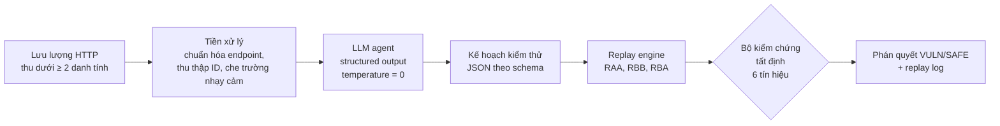

# AuthSentry: Phát hiện IDOR/BOLA black-box có LLM-agent hỗ trợ qua kiểm chứng vi sai đa vai trò

> **Báo cáo tóm tắt và phân tích công cụ AuthSentry**
> Nguồn: Lu, X., Lian, Y., Lu, X., Gao, Y. (2026). *LLM-Agent Assisted Black-Box Detection of IDOR/BOLA via Multi-Role Differential Validation*. 2026 10th International Conference on Electronic Information Technology and Computer Engineering (EITCE), IEEE. DOI: [10.1109/EITCE70137.2026.11634569](https://doi.org/10.1109/EITCE70137.2026.11634569)
> Công cụ trong bài được gọi là **AuthSentry** (viết hoa "AUTHSENTRY" trong bài). Bài báo không nêu địa chỉ mã nguồn công khai; thực nghiệm dựa trên một gói artifact `idor_experiment_artifact.zip` đi kèm bài.

---

## Mục lục

1. [Tổng quan](#1-tổng-quan)
2. [Bối cảnh và động cơ](#2-bối-cảnh-và-động-cơ)
3. [Mô hình bài toán](#3-mô-hình-bài-toán)
4. [Phương pháp](#4-phương-pháp)
5. [Triển khai](#5-triển-khai)
6. [Đánh giá thực nghiệm](#6-đánh-giá-thực-nghiệm)
7. [Hạn chế](#7-hạn-chế)
8. [Nhận xét phản biện](#8-nhận-xét-phản-biện)
9. [So sánh với Links2CPN và AuthProbe](#9-so-sánh-với-links2cpn-và-authprobe)
10. [Hướng phát triển](#10-hướng-phát-triển)
11. [Tài liệu tham khảo chính](#11-tài-liệu-tham-khảo-chính)

---

## 1. Tổng quan

| Mục | Nội dung |
|---|---|
| **Tên công cụ** | AuthSentry |
| **Mục tiêu** | Phát hiện IDOR/BOLA trong Web API theo kiểu black-box |
| **Ý tưởng cốt lõi** | **Tách** suy luận ngữ nghĩa (do LLM agent làm) khỏi **quyết định lỗ hổng** (do bộ kiểm chứng tất định làm) |
| **Đầu vào** | Lưu lượng HTTP thu được dưới ≥ 2 danh tính (request/response) và thông tin xác thực của các danh tính đó; không cần mã nguồn, schema CSDL hay log máy chủ |
| **Vai trò của LLM** | Trích endpoint nhạy cảm về phân quyền, tham số định danh đối tượng, gợi ý chủ sở hữu và **kế hoạch kiểm thử chéo người dùng** có cấu trúc |
| **Bộ kiểm chứng** | Gửi 3 request (chủ sở hữu, không phải chủ sở hữu, chéo) và phán quyết bằng luật tất định trên mã trạng thái, định danh, trường chủ sở hữu, trường nhạy cảm, tín hiệu từ chối và độ tương đồng phản hồi |
| **Triển khai** | ~5.400 dòng Python 3.11 (`httpx`, `mitmproxy`, `jsonpath-ng`, `rapidfuzz`); backend LLM: GPT-4o, DeepSeek-V3, Qwen2.5-72B-Instruct (qua vLLM) |
| **Kết quả chính** | Trên artifact FastAPI có kiểm soát (10 endpoint, 5 lỗ hổng gài sẵn): TP=5, FP=0, FN=0, TN=5 → Precision = Recall = F1 = 100% |

---

## 2. Bối cảnh và động cơ

- IDOR/BOLA đứng đầu OWASP API Security Top 10: API nhận định danh đối tượng từ client mà không xác minh người gọi có quyền với đối tượng đó.
- **DAST truyền thống và fuzzer REST** chủ yếu dựa vào mã trạng thái và chèn payload, nên không biết đối tượng trả về có thuộc về người gọi hay không.
- **LLM agent** hiểu được ngữ nghĩa đường dẫn, tên tham số, trường phản hồi (ví dụ PentestGPT), nhưng nếu để LLM làm "thẩm phán" lỗ hổng thì dễ sinh **dương tính giả do ảo giác** (hallucination).
- **Khoảng trống bài báo nhắm tới:** tận dụng khả năng hiểu ngữ nghĩa của LLM để sinh kế hoạch kiểm thử, nhưng giao việc kết luận cho một bộ kiểm chứng tất định dựa trên so sánh phản hồi giữa các người dùng.
- Các công trình liên quan được nhắc: PentestGPT (pentest bằng LLM), AutoRestTest và KAT (kiểm thử API tổng quát bằng LLM/đa tác tử), Che và cs. (lệch phạm vi API trong hệ sinh thái app-in-app).

**Đóng góp (theo bài báo):**
1. Khung phát hiện IDOR/BOLA black-box kết hợp sinh kế hoạch kiểm thử có LLM dẫn hướng và kiểm chứng vi sai đa vai trò tất định.
2. Hình thức hóa luật quyết định dựa trên mã trạng thái, định danh, chỉ báo chủ sở hữu, trường nhạy cảm và độ tương đồng phản hồi.
3. Đánh giá tái lập được trên artifact FastAPI có kiểm soát.

---

## 3. Mô hình bài toán

- Tester có **ít nhất hai danh tính** `U = {uA, uB, ...}` (vai trò giống hoặc khác nhau) và một tập lưu lượng `T` thu dưới các danh tính đó. Không có mã nguồn, schema CSDL hay log máy chủ.
- Endpoint *e* có IDOR/BOLA nếu tồn tại một dạng request `q(e, oA)` sao cho khi gửi bằng thông tin của `uB`, phản hồi `RBA` thỏa **cả ba điều kiện**:
  - (a) mã trạng thái thành công;
  - (b) thân phản hồi chứa bằng chứng về `oA` được bảo vệ: khớp định danh chính xác, khớp trường chủ sở hữu, hoặc lộ trường nhạy cảm cũng có trong phản hồi tham chiếu `RAA` của `uA`;
  - (c) không có tín hiệu từ chối.
- **Ngoài phạm vi:** injection, vượt xác thực, CAPTCHA, MFA, từ chối dịch vụ.

---

## 4. Phương pháp



Quy trình có ba giai đoạn: (i) thiết lập bài toán, (ii) sinh ứng viên có LLM dẫn hướng, (iii) kiểm chứng vi sai đa vai trò. **LLM không bao giờ thấy phản hồi replay và không bao giờ trả về nhãn Boolean**; bộ kiểm chứng là "thẩm phán" duy nhất.

### 4.1. Tiền xử lý lưu lượng

- Lọc tài nguyên tĩnh và host ngoài phạm vi.
- Chuẩn hóa thành dòng endpoint dạng `(method, host, path template, params, header keys, body schema)`; định danh cụ thể trong path được trừu tượng hóa (ví dụ `/api/orders/1387` → `/api/orders/{id}`) để khử trùng lặp.
- Thu thập định danh ứng viên bằng **regex + heuristic entropy**: ID số, UUID, token base64, chuỗi dạng slug, tên tham số quen thuộc.
- Với mỗi endpoint, dựng schema phản hồi đại diện **giới hạn ≤ 1 KB**; các trường có vẻ nhạy cảm bị **che (mask)** trước mọi lần gọi LLM.

### 4.2. Suy luận bị ràng buộc bởi schema (LLM agent)

- Một lần gọi LLM **một lượt, structured output** cho mỗi endpoint, `temperature = 0`, kiểm tra bằng JSON schema cứng.
- Prompt gồm: chỉ dẫn hệ thống **cấm mô hình tuyên bố có lỗ hổng**, dòng endpoint, tối đa 3 đoạn request/response đã che, và ghi chú đối chiếu các định danh từng xuất hiện dưới các danh tính khác nhau.
- Đầu ra là kế hoạch ứng viên với các trường:
  - `is_authorization_sensitive`, `object_params`, `resource_type`, `owner_indicators`, `sensitive_fields`, `required_roles`;
  - một trong **5 chiến lược replay**: `path_id_swap`, `query_id_swap`, `body_id_swap`, `header_id_swap`, `token_only_swap`.
- Đầu ra sai định dạng được thử lại một lần, nếu vẫn lỗi thì bỏ.
- Vì LLM không thấy phản hồi replay và không trả nhãn, các "xác nhận lỗ hổng do ảo giác" không thể vượt qua bộ kiểm chứng tất định.

### 4.3. Kiểm chứng vi sai đa vai trò

Với mỗi kế hoạch, bộ sinh ứng viên ghép định danh `oA` (quan sát dưới `uA`) với danh tính khác `uB` và định danh cùng kiểu `oB` thuộc `uB`. Replay engine gửi theo thứ tự ngẫu nhiên, có jitter, ba request tất định:

```text
RAA = e(uA, oA)    # chủ sở hữu truy cập đối tượng của mình (tham chiếu)
RBB = e(uB, oB)    # người dùng B truy cập đối tượng của mình
RBA = e(uB, oA)    # người dùng B truy cập đối tượng của A (request vi phạm quyền)
```

- Phương thức thay đổi trạng thái được dẫn tới **endpoint đọc lại an toàn** nếu có, nếu không thì chạy **dry-run trên đối tượng seed dùng một lần**.

**Sáu tín hiệu** tính trên bộ ba phản hồi:

| Tín hiệu | Ý nghĩa |
|---|---|
| `S_stat` | Mã trạng thái thành công (đồng nhất) |
| `S_id` | Khớp định danh |
| `S_own` | Chỉ báo chủ sở hữu trong `RBA` bằng của `RAA` nhưng khác của `RBB` |
| `S_sens` | Lộ trường nhạy cảm |
| `S_sch` | Độ tương đồng schema: Jaccard giữa tập đường dẫn JSON của `RBA` và `RAA` |
| `S_deny` | Tín hiệu từ chối (regex trên mã trạng thái và thân cho 401/403 hoặc cụm từ từ chối) |

**Luật quyết định tất định (công thức 2 trong bài):**

```text
VULN ⇔ S_stat ∧ ¬S_deny ∧ (S_id ∨ S_own)  ∨  (S_sens ∧ S_sch ≥ τ)
```

với **τ = 0,85**, được cho là suy ra từ một tập hiệu chỉnh giữ riêng (held-out calibration set). Bài nhấn mạnh luật này **bảo thủ**: cần cả tín hiệu sở hữu dương lẫn không có tín hiệu từ chối, nhằm tránh lỗi điển hình của cách dùng LLM đơn thuần là coi một `200 OK` với thân rỗng là rò rỉ.

---

## 5. Triển khai

- ~5.400 dòng Python 3.11; thư viện: `httpx` (HTTP), `mitmproxy` (thu lưu lượng), `jsonpath-ng` (đường dẫn JSON), `rapidfuzz` (so khớp mờ).
- **Backend LLM hoán đổi được:** GPT-4o, DeepSeek-V3, Qwen2.5-72B-Instruct (chạy qua vLLM). Logic quyết định lỗ hổng không đổi khi đổi nhà cung cấp LLM.
- Mỗi quyết định giữ lại **replay log** (phản hồi chủ sở hữu, replay không phải chủ sở hữu, vết mã trạng thái, điểm tương đồng) để rà soát thủ công và dùng trong CI.

---

## 6. Đánh giá thực nghiệm

### 6.1. Câu hỏi nghiên cứu

- **RQ1 (đúng đắn phát hiện):** có phân tách được endpoint IDOR/BOLA gài sẵn với endpoint được bảo vệ đúng không?
- **RQ2 (bằng chứng replay):** bằng chứng mã trạng thái và độ tương đồng nào hậu thuẫn mỗi phán quyết?
- **RQ3 (tái lập):** kết quả có tái lập tự động từ script và log được cung cấp không?

### 6.2. Thiết lập

- **Mục tiêu:** dịch vụ giả FastAPI, hai người dùng: User A (id `101`, token `token_a`) và User B (id `102`, token `token_b`).
- **10 endpoint** trên tài nguyên thuộc người dùng (hồ sơ, đơn hàng, tài liệu riêng, cài đặt tài khoản, cập nhật e-mail, chuyển khoản).

| Nhóm | Đường dẫn | Số endpoint | Có lỗ hổng | Kiểm tra |
|---|---|---:|---:|---|
| Safe | `/safe/users/{user_id}/...` | 5 | 0 | Token + sở hữu |
| Vulnerable | `/vuln/users/{user_id}/...` | 5 | 5 | Chỉ token |
| **Tổng** | | **10** | **5** | |

- Mỗi endpoint vulnerable có một endpoint safe tương ứng về ngữ nghĩa, để kiểm tra công cụ phát hiện thiếu kiểm tra sở hữu chứ không chỉ phản ứng theo tên endpoint.
- Tái lập bằng `run_experiment.py`: chọn cổng TCP rảnh, khởi động FastAPI, chờ `/openapi.json`, quét 10 endpoint, ghi `experiment_logs.json` và `results.csv`, rồi tắt server.
- Độ tương đồng tính bằng Jaccard trên tập đặc trưng JSON đã làm phẳng; **τ = 0,85** cố định. Nhãn do bộ kiểm chứng tất định tạo ra, LLM không làm oracle.

### 6.3. Kết quả

**Bảng II – Bằng chứng replay theo endpoint**

| API | Tài nguyên | Ground truth | Mã `R_BA` | Độ tương đồng | Dự đoán |
|---|---|---|---:|---:|---|
| /safe | Profile | SAFE | 403 | 0,00 | SAFE |
| /safe | Orders | SAFE | 403 | 0,00 | SAFE |
| /safe | Documents | SAFE | 403 | 0,00 | SAFE |
| /safe | Email | SAFE | 403 | 0,00 | SAFE |
| /safe | Transfer | SAFE | 403 | 0,00 | SAFE |
| /vuln | Profile | VULN | 200 | 1,00 | VULN |
| /vuln | Orders | VULN | 200 | 1,00 | VULN |
| /vuln | Documents | VULN | 200 | 1,00 | VULN |
| /vuln | Settings | VULN | 200 | 1,00 | VULN |
| /vuln | Transfer | VULN | 200 | 0,89 (0,894737) | VULN |

**Bảng III – Chỉ số tổng hợp**

| Phương pháp | TP | FP | FN | TN | Precision | Recall | F1 |
|---|---:|---:|---:|---:|---:|---:|---:|
| AuthSentry | 5 | 0 | 0 | 5 | 1,000 | 1,000 | 1,000 |

**Diễn giải của tác giả:**
- **RQ1:** cả 10 endpoint được phân loại đúng; endpoint safe từ chối `R_BA` bằng 403 (độ tương đồng 0 vì thân là thông báo từ chối), endpoint vulnerable trả đối tượng của A cho B.
- **RQ2:** kết quả không chỉ dựa vào mã trạng thái: ở endpoint safe, `R_AA` và `R_BB` đều 200 nhưng `R_BA` bị 403 nên được xếp là safe. Endpoint transfer vulnerable có độ tương đồng thấp hơn (0,894737) do phản hồi chứa trường riêng của thao tác, nhưng vẫn trên ngưỡng 0,85.
- **RQ3:** artifact tự chứa dịch vụ đích, detector, script tự động, log JSON và CSV; chạy lại cho cùng chỉ số tổng hợp.
- **Baseline DAST (nêu bằng lời):** công cụ DAST thông thường sẽ gắn cờ mọi endpoint trả HTTP 200, cho FP = 5, recall = 1,0, precision = 0,5 trên artifact này.
- **Hiệu quả (nêu "sơ bộ"):** AuthSentry gửi đúng **3 request/endpoint**, so với **6–12** của quét thụ động OWASP ZAP.

---

## 7. Hạn chế

Theo chính bài báo:
1. Artifact chỉ kiểm chứng **replay oracle**, không đo crawl quy mô lớn, phân cấp vai trò hay sự đa dạng của API thực tế.
2. Mọi định danh đều **hiển thị rõ trong đường dẫn URL**; định danh được mã hóa hoặc tham chiếu lồng trong thân request cần cơ chế thu thập bổ sung.
3. Thực nghiệm **một bước**; workflow nhiều bước cần replay nhận biết chuỗi.
4. Kết quả cần được hiểu là xác nhận tính đúng đắn và khả năng tái lập, **không phải** tuyên bố về hiệu năng triển khai thực tế.
5. Ba thí nghiệm bổ sung chỉ ở mức kế hoạch (chưa thực hiện): endpoint có phân cấp quyền phức tạp (theo vai trò/nhóm), tham số định danh bị đổi tên (ví dụ `x_id`), và so sánh hiệu quả quét (số request, thời gian) với DAST (ZAP, Burp Suite).

---

## 8. Nhận xét phản biện

Phần này là nhận xét của người viết báo cáo, dựa trên nội dung bài.

### Điểm mạnh

- **Nguyên tắc thiết kế rõ ràng:** LLM chỉ đề xuất, bộ kiểm chứng tất định kết luận; LLM không thấy phản hồi replay và không trả nhãn. Mô hình này hợp lý để hạn chế dương tính giả do ảo giác.
- **Minh bạch, dễ kiểm toán:** mỗi phán quyết đi kèm `R_AA`, `R_BB`, `R_BA`, vết trạng thái và điểm tương đồng.
- **Che dữ liệu nhạy cảm** trước khi gọi LLM và giới hạn kích thước schema (≤ 1 KB) là cân nhắc thực tế về quyền riêng tư và chi phí.
- **Hỗ trợ nhiều backend LLM** (cả mô hình mã nguồn mở chạy cục bộ), logic quyết định độc lập với nhà cung cấp.
- Bài **thừa nhận** quy mô nhỏ và diễn giải kết quả ở mức "kiểm chứng đúng đắn".

### Điểm cần thận trọng

1. **Đánh giá quá nhỏ và quá "sạch":** 10 endpoint, 2 người dùng, và endpoint vulnerable chỉ kiểm tra token trong khi endpoint safe luôn trả 403 rõ ràng. Phân loại ở đây gần như tầm thường; kết quả 100% không cho biết độ chính xác trên API thực (phản hồi lỗi dùng 200 kèm thân lỗi, 404 thay cho 403, dữ liệu động, phân trang...).
2. **Vai trò của LLM không được đo.** Phần đánh giá nói rõ nhãn do bộ kiểm chứng tất định sinh ra và LLM không phải oracle, nhưng bài không báo cáo kết quả của giai đoạn sinh kế hoạch (LLM nào, bao nhiêu kế hoạch đúng/sai, thất bại schema, ablation có/không LLM). Vì vậy tuyên bố "loại bỏ dương tính giả do ảo giác trong khi giữ recall" chủ yếu là lập luận thiết kế, chưa được kiểm chứng bằng thực nghiệm. Ngoài ra, nếu LLM bỏ sót một endpoint nhạy cảm (đánh dấu `is_authorization_sensitive = false` hay sai chiến lược replay) thì validator không có cơ hội kiểm tra → ảnh hưởng recall mà bài chưa phân tích.
3. **Baseline DAST chủ yếu là lập luận, không phải số đo.** Bảng III được đặt tiêu đề là so sánh với ZAP nhưng chỉ chứa một dòng của AuthSentry; con số FP = 5, precision = 0,5 được nêu như một suy luận ("would flag all endpoints returning HTTP 200").
4. **Mâu thuẫn nội bộ về so sánh với DAST:** phần Setup nói so sánh hiệu quả với DAST là thí nghiệm *chưa thực hiện*, nhưng phần Interpretation lại nêu kết quả "sơ bộ" 3 request so với 6–12 request của ZAP passive scan. Quét thụ động (passive) của ZAP vốn không chủ động gửi các request kiểm thử, nên so sánh số request này cần được mô tả rõ.
5. **Khẳng định về tham số bị đổi tên chưa được thử nghiệm.** RQ3 nói việc đổi tên tham số định danh (ví dụ `x_id`) "không ảnh hưởng", trong khi thí nghiệm (ii) về việc này được liệt kê là *chưa thực hiện*. Lập luận (hoán đổi giá trị định danh bất kể tên) hợp lý, nhưng khâu LLM/harvest định danh vẫn có thể bị ảnh hưởng.
6. **Công thức (2) mơ hồ về thứ tự ưu tiên toán tử.** Nếu `∨` có độ ưu tiên thấp hơn `∧` như quy ước thông thường, nhánh `(S_sens ∧ S_sch ≥ τ)` sẽ được kích hoạt kể cả khi có tín hiệu từ chối, trái với mô tả "cần cả hai điều kiện" trong văn bản. Cũng cần làm rõ cách `S_sch ≥ τ` (dùng Jaccard theo đường dẫn JSON) liên hệ với độ tương đồng Jaccard trên "tập đặc trưng JSON đã làm phẳng" được dùng trong thực nghiệm.
7. **Hiệu chỉnh τ không được mô tả:** bài nói τ = 0,85 lấy từ tập hiệu chỉnh giữ riêng nhưng không nêu tập đó là gì; trong thực nghiệm, ca transfer (0,894737) chỉ cách ngưỡng khoảng 0,045.
8. **Phạm vi hẹp:** chỉ endpoint có định danh trong đường dẫn, một bước, hai người dùng; thao tác ghi chạy ở chế độ dry-run hoặc trên đối tượng seed (chưa đánh giá tính an toàn trên hệ thống thật).
9. **Tính sẵn có:** bài không nêu kho mã nguồn công khai; tuyên bố tái lập dựa trên artifact được "cung cấp" kèm bài.
10. Bài là báo cáo hội nghị ngắn (4 trang), tác giả đến từ các khoa kinh tế, kế toán, y học lâm sàng và quản lý, nên đây là nghiên cứu mang tính **khái niệm / chứng minh nguyên lý** hơn là đánh giá thực địa.

---

## 9. So sánh với Links2CPN và AuthProbe

| Tiêu chí | Links2CPN | AuthProbe | AuthSentry |
|---|---|---|---|
| Cách tiếp cận | Phân tích **log** bằng Colored Petri Net (bị động, offline) | Quét **chủ động** theo đặc tả OpenAPI bằng nhiều danh tính | Quét **chủ động** dựa trên lưu lượng đã thu + LLM sinh kế hoạch |
| Nguồn "hiểu API" | OpenAPI **có `links`** | OpenAPI (cặp collection/item) | **Lưu lượng HTTP** + suy luận ngữ nghĩa của LLM |
| Xác định quyền sở hữu | Token cấp bởi phản hồi trước đó (luồng dữ liệu CPN) | Thao tác **liệt kê (collection)** của chính API | Chỉ báo chủ sở hữu do LLM đề xuất + tín hiệu `S_own` từ replay |
| Cách xác nhận rò rỉ | Transition không kích hoạt được (vi phạm luồng dữ liệu) | `ok ∧ obj ∧ id(r) = id(o)` | 6 tín hiệu (trạng thái, ID, chủ sở hữu, trường nhạy cảm, tương đồng schema, từ chối) |
| Vai trò LLM | Không | Không | Có (sinh kế hoạch; **không** quyết định) |
| Yêu cầu danh tính | Không (phân tích log) | ≥ 2 | ≥ 2 |
| Tích hợp CI | Không nhắm tới | Có (exit code, JUnit, JSON...) | Nêu như lợi ích tiềm năng (replay log, ít request) |
| Phạm vi | BOLA trên log (đọc/ghi tùy log) | Đường **đọc** (GET) | Có xử lý thao tác ghi qua read-back/dry-run |
| Quy mô đánh giá | Juice Shop, CTF 15 sinh viên, Memos | Hai dịch vụ tổng hợp (vulnerable/hardened) | Một dịch vụ FastAPI, 10 endpoint |
| Dạng nguồn | Tạp chí (IJIS 2025) | Preprint arXiv 2026 | Hội nghị IEEE (EITCE 2026) |

**Điểm chung:** cả AuthProbe và AuthSentry dựa vào ý tưởng **kiểm thử vi sai đa danh tính** và đều đánh giá trên môi trường tổng hợp nhỏ; Links2CPN là hướng bổ trợ (phát hiện khai thác thực sự trong log vận hành). Điểm khác biệt của AuthSentry là dùng LLM để giảm công sức dựng cấu hình, nhưng bài chưa chứng minh bằng thực nghiệm giá trị gia tăng của LLM so với cách suy ra tài nguyên theo quy ước như AuthProbe.

---

## 10. Hướng phát triển

- Mở rộng oracle sang **bộ API lớn hơn**, ma trận phân quyền đa vai trò, **định danh bị mã hóa** và **lỗi phụ thuộc chuỗi thao tác**.
- Thực hiện ba thí nghiệm đang ở dạng kế hoạch: phân cấp quyền phức tạp, tham số bị đổi tên, so sánh hiệu quả với ZAP/Burp.
- **Ablation** theo từng tín hiệu và có/không LLM để chứng minh giá trị của từng thành phần (bài tự nhận artifact cho phép làm điều này).
- Bổ sung đánh giá trên API thực hoặc benchmark công khai, báo cáo số liệu FP/FN thực tế, và đo chất lượng giai đoạn sinh kế hoạch của LLM.

---

## 11. Tài liệu tham khảo chính

1. Lu, X., Lian, Y., Lu, X., Gao, Y. *LLM-Agent Assisted Black-Box Detection of IDOR/BOLA via Multi-Role Differential Validation*. 2026 10th Int. Conf. on Electronic Information Technology and Computer Engineering (EITCE), IEEE. <https://doi.org/10.1109/EITCE70137.2026.11634569>
2. OWASP Foundation. *OWASP API Security Top 10 – 2023 Edition*. <https://owasp.org/API-Security/>
3. Deng, G. và cs. *PentestGPT: Evaluating and Harnessing Large Language Models for Automated Penetration Testing*. USENIX Security (2024).
4. Kim, M. và cs. *A Multi-Agent Approach for REST API Testing with Semantic Graphs and LLM-Driven Inputs* (AutoRestTest). arXiv:2411.07098 (2024).
5. Le, T. và cs. *KAT: Dependency-Aware Automated API Testing with Large Language Models*. ICST (2024). <https://doi.org/10.1109/ICST60714.2024.00017>
6. Barabanov, A. và cs. *Automatic detection of access control vulnerabilities via API specification processing*. arXiv:2201.10833 (2022).
7. Kushnir, M. và cs. *Automated Black Box Detection of HTTP GET Request-Based Access Control Vulnerabilities in Web Applications*. ICISSP (2021).
8. Che, J. và cs. *Uncovering API-Scope Misalignment in the App-in-App Ecosystem*. Proc. ACM Softw. Eng. 2 (ISSTA), 2025. <https://doi.org/10.1145/3728962>
9. Zhang, Z. và cs. *Agent Security Bench (ASB)*. ICLR (2025). arXiv:2410.02644
10. Santos Filho, A., Rodríguez, R. J., Feitosa, E. L. *Links2CPN*. Int. J. Inf. Secur. 24, 83 (2025). *(Báo cáo trước trong cuộc trò chuyện này.)*
11. Barach, J. *AuthProbe*. arXiv:2607.20574 (2026). *(Báo cáo trước trong cuộc trò chuyện này.)*
