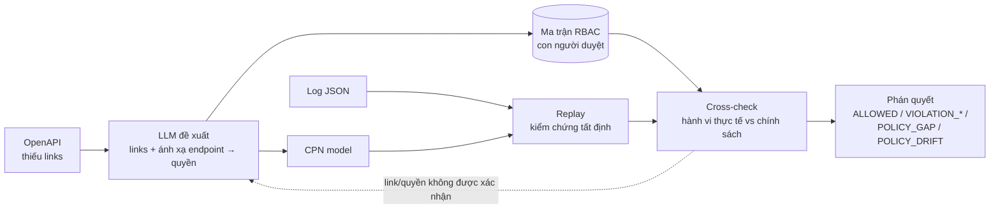

# Lập luận: vì sao tích hợp LLM và ma trận RBAC vào Links2CPN là hợp lý

> Tài liệu tổng hợp từ phân tích Links2CPN, AuthProbe và AuthSentry trong các tệp trước (`Links2CPN_Report.md`, `AuthProbe_Report.md`, `AuthSentry_Report.md`, `RBAC_Compatibility.md`, `Synthesis_and_RBAC_Solutions.md`).
>
> **Quy ước độ tin cậy:** nội dung *"Từ bài báo"* trích từ các bài gốc; *"Suy luận"* là phân tích của người viết, **chưa được kiểm chứng bằng thực nghiệm**.

---

## Mục lục

1. [Lý do cốt lõi](#1-lý-do-cốt-lõi)
2. [Lập luận từng bước](#2-lập-luận-từng-bước)
3. [Vòng kiểm soát lẫn nhau](#3-vòng-kiểm-soát-lẫn-nhau)
4. [Điều nên nói thẳng với hội đồng](#4-điều-nên-nói-thẳng-với-hội-đồng)
5. [Ba giả thuyết khai báo trước](#5-ba-giả-thuyết-khai-báo-trước)
6. [Phản biện thường gặp và cách trả lời](#6-phản-biện-thường-gặp-và-cách-trả-lời)
7. [Kết luận](#7-kết-luận)

---

## 1. Lý do cốt lõi

**Links2CPN có hai điểm nghẽn, và mỗi điểm được tháo bằng đúng một thành phần mới. Hai thành phần này lại kiểm soát lỗi của nhau.**

| Điểm nghẽn của Links2CPN (theo chính bài gốc) | Thành phần giải quyết | Vì sao an toàn |
|---|---|---|
| Cần trường `links`, nhưng chỉ **9/1.955** đặc tả OpenAPI (APIs.guru) có | **LLM** đề xuất `links` | Replay trên log kiểm chứng tất định từng link |
| Giả định "vi phạm luồng dữ liệu = BOLA" sai khi có vai trò đặc quyền | **Ma trận RBAC** làm oracle tường minh | Ma trận do con người duyệt, `deny-by-default` |

---

## 2. Lập luận từng bước

### 2.1. RBAC là điều kiện để giả định của bài còn đúng

- *Từ bài báo:* Links2CPN giả định mọi vi phạm luồng dữ liệu đều tương ứng với tấn công BOLA.
- *Suy luận:* với Admin hợp lệ đọc giỏ hàng của người khác, token không khớp → transition không kích hoạt → **bị báo nhầm (dương tính giả)**. Cần kiểm chứng bằng thực nghiệm.
- *Từ bài báo:* chính bài nêu CPN có thể "tô màu" để biểu diễn **vai trò người dùng**, định danh tài nguyên và trạng thái hệ thống, nhưng cài đặt thực tế không có vai trò (token chỉ chứa định danh đối tượng và `user_id`, thực chất là địa chỉ IP trong thông báo lỗi minh họa). Thêm ma trận là **hoàn thiện thiết kế mà tác giả đã tuyên bố**, không phải gắn thêm phần ngoài.
- *Từ bài báo:* Precision của V2 chỉ **0,22** khi xét tấn công thành công, và bài thừa nhận cần thêm heuristic. Ma trận cung cấp tiêu chí hợp lệ để phân biệt, thay cho heuristic tùy ý.

### 2.2. LLM giải quyết rào cản áp dụng, và hướng này do chính tác giả gợi ý

- Không có `links`, công cụ gần như không chạy được (khoảng 0,5% đặc tả công khai có trường này).
- *Từ bài báo:* tác giả nói đội phát triển có thể dùng công cụ AI để tạo và cải thiện đặc tả OpenAPI, và trích khảo sát cho thấy 28% người dùng AI để sinh tài liệu API.
- LLM còn giúp dựng **bản nháp ma trận** (ánh xạ endpoint → quyền), việc thủ công và tốn công nhất.

### 2.3. Nhược điểm của mỗi phần được phần kia bù

- LLM đơn lẻ có nguy cơ **ảo giác** (AuthSentry cũng nêu và tránh bằng cách tách LLM khỏi phán quyết).
- Links2CPN vốn là bộ kiểm chứng **tất định**: replay luôn cho kết quả "kích hoạt được" hoặc "không". Vì vậy mọi `link` hay ánh xạ quyền do LLM đề xuất đều bị kiểm tra trên log và đối chiếu ma trận trước khi được tin.
- Thiếu bất kỳ mảnh nào thì mất một thuộc tính:

| Thiếu | Hệ quả |
|---|---|
| Không có LLM | Không áp dụng rộng được (thiếu `links`) |
| Không có ma trận | Báo nhầm với vai trò đặc quyền, bỏ sót lỗi chức năng |
| Không có CPN/replay | Không có bộ kiểm chứng tất định cho đề xuất của LLM |

### 2.4. Khoảng trống này chưa ai lấp

- AuthProbe và AuthSentry đều dùng **oracle ngầm** về quyền sở hữu (collection của API; so sánh phản hồi chéo), chưa có ma trận tường minh.
- AuthSentry có nguyên tắc "LLM đề xuất, kiểm chứng tất định" nhưng chưa đo vai trò của LLM, và dùng replay chủ động thay vì mô hình hình thức.

---

## 3. Vòng kiểm soát lẫn nhau

**Nguyên tắc:** LLM chỉ *đề xuất* (nhanh, recall cao); **CPN + ma trận kiểm chứng** (tất định, có thể kiểm toán). LLM không bao giờ là oracle kết luận lỗ hổng.

---

## 4. Điều nên nói thẳng với hội đồng

Lập luận trên là **giả thuyết có cơ sở, chưa phải kết quả đã chứng minh**. Hai thành phần cũng không mạnh như nhau:

| Thành phần | Mức biện minh | Lý do |
|---|---|---|
| **RBAC** | Mạnh hơn | Sửa một lỗi cơ chế rõ ràng (báo nhầm vai trò đặc quyền, bỏ sót BFLA) |
| **LLM** | Có điều kiện | Phản biện chắc chắn sẽ gặp: *"dùng quy tắc theo quy ước như AuthProbe (collection/item) có đủ không?"* |

Câu trả lời hợp lý: LLM xử lý được tên gọi không theo quy ước (ví dụ `bid` với `basketId`), nhưng phải **chứng minh bằng ablation** so sánh ba cấu hình: *có LLM*, *chỉ dùng quy tắc*, *không dùng gì*.

---

## 5. Ba giả thuyết khai báo trước

Để lập luận có thể bị bác bỏ bằng số liệu:

| Giả thuyết | Chỉ số | Bị bác bỏ nếu |
|---|---|---|
| **H1:** LLM tăng số đặc tả chạy được | % đặc tả có đủ `links` sau kiểm chứng | Tăng không đáng kể so với quy tắc đơn thuần |
| **H2:** Ma trận giảm dương tính giả của vai trò đặc quyền | FP trên truy cập hợp lệ của Admin/Manager | FP không giảm so với Links2CPN gốc |
| **H3:** Link do LLM đề xuất đủ chính xác sau kiểm chứng | Precision/Recall so với tập link vàng (gán nhãn thủ công) | Phần lớn link phải bị loại, LLM không có giá trị gia tăng |

---

## 6. Phản biện thường gặp và cách trả lời

| Phản biện | Trả lời |
|---|---|
| *"Dùng quy tắc collection/item như AuthProbe là đủ, sao cần LLM?"* | Chỉ đúng khi API theo quy ước. LLM xử lý tên không theo quy ước; giá trị gia tăng được kiểm bằng ablation (H1, H3). Nếu không có giá trị, bỏ LLM và giữ quy tắc. |
| *"LLM gây ảo giác, sao tin được?"* | Không tin trực tiếp: mọi đề xuất phải qua replay trên log và đối chiếu ma trận; đề xuất không được xác nhận bị loại. |
| *"Ma trận sai thì sao?"* | Dùng `deny-by-default` để lộ `POLICY_GAP`; so sánh với hành vi thực tế để lộ `POLICY_DRIFT`; con người duyệt. Đo độ nhạy với ma trận bị sai có chủ đích. |
| *"Phân tích log chỉ phát hiện sau khi bị tấn công."* | Đúng; vì vậy Links2CPN đặt ở lớp giám sát và có thể kết hợp quét chủ động trước triển khai. |
| *"Thêm hai thành phần làm hệ thống phức tạp."* | Chấp nhận có chi phí; kiểm soát bằng ablation để chỉ giữ thành phần chứng minh được giá trị. |

---

## 7. Kết luận

1. **RBAC** sửa một giả định yếu của Links2CPN và hiện thực hóa ý tưởng "tô màu vai trò" mà bài gốc đã nêu.
2. **LLM** mở rộng khả năng áp dụng bằng cách giảm phụ thuộc vào trường `links` hiếm gặp, với điều kiện giá trị của nó được chứng minh bằng ablation.
3. **CPN + replay + ma trận** làm bộ kiểm chứng tất định, nên rủi ro ảo giác của LLM được kiểm soát; ngược lại LLM giảm công sức dựng `links` và ma trận.
4. Đây là **giả thuyết cần kiểm chứng**; kết luận cuối cùng chỉ nên chốt sau khi có số liệu cho H1–H3.
